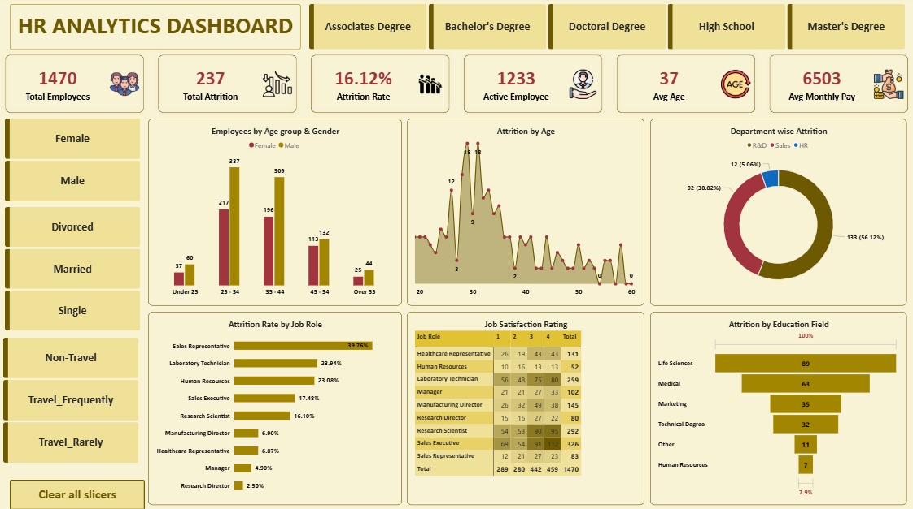

# HR Analytics Dashboard | Employee Attrition Analysis

## 📌 Project Overview

The HR Analytics Dashboard is a data analytics project designed to analyze employee demographics, workforce distribution, employee attrition, job satisfaction, and department-wise workforce trends.

The dashboard provides an interactive view of HR metrics, helping HR professionals and business stakeholders understand employee turnover patterns, identify potential workforce challenges, and support data-driven HR decisions.

## 🎯 Project Objectives

- Analyze overall employee demographics and workforce distribution.
- Measure employee attrition and calculate the attrition rate.
- Identify age groups with higher employee attrition.
- Compare attrition across different departments and job roles.
- Evaluate employee job satisfaction ratings.
- Analyze attrition patterns across different education fields.
- Provide interactive filters for exploring HR data.
- 
## Dashboard Preview


## 📊 Dashboard KPIs

| KPI | Value |
|---|---:|
| Total Employees | 1,470 |
| Total Attrition | 237 |
| Attrition Rate | 16.12% |
| Active Employees | 1,233 |
| Average Age | 37 |
| Average Monthly Pay | 6,503 |

## 📈 Dashboard Visualizations

The dashboard contains the following visualizations:

1. **Employees by Age Group & Gender:** Compares employee distribution across different age groups and genders.
2. **Attrition by Age:** Shows employee attrition patterns across different ages.
3. **Department-wise Attrition:** Analyzes employee attrition across R&D, Sales, and HR departments.
4. **Attrition Rate by Job Role:** Identifies job roles with comparatively higher attrition rates.
5. **Job Satisfaction Rating:** Analyzes employee satisfaction ratings across different job roles.
6. **Attrition by Education Field:** Examines employee attrition across different educational backgrounds.

## 🎛️ Interactive Dashboard Filters

The dashboard includes interactive slicers to explore employee data based on:

- Education Level
- Gender
- Marital Status
- Business Travel Frequency

These filters allow users to dynamically explore HR metrics and compare employee attrition across different categories.

## 🔍 Key Insights

Based on the dashboard:

- The organization has 1,470 employees, of whom 237 have left the organization.
- The overall employee attrition rate is 16.12%.
- The organization currently has 1,233 active employees.
- R&D accounts for 133 attrition cases, followed by Sales with 92 and HR with 12.
- Sales Representatives have the highest displayed attrition rate among the listed job roles at 39.76%.
- Laboratory Technicians have a displayed attrition rate of 23.94%.
- Human Resources has a displayed attrition rate of 23.08%.
- Life Sciences is the education field with the highest displayed attrition count (89).

## 🛠️ Tools & Technologies

- Microsoft Power BI – Dashboard development and data visualization.
- Power Query – Data transformation and preparation (if used).
- DAX – Measures and KPI calculations (if used).
- Microsoft Excel / CSV – Data storage and preparation (depending on the source file).

## 📁 Repository Structure

```text
HR-Analytics-Dashboard/
│
├── README.md
│
├── Dashboard/
│   └── HR_Analytics_Dashboard.pbix
│
├── Dataset/
│   └── HR_Analytics.csv
│
├── Images/
│   └── HR_Analytics_Dashboard.png
│
└── Documentation/
    └── Project_Overview.pdf
```

## 💡 Business Value

This dashboard helps HR teams:

- Monitor employee attrition and workforce trends.
- Identify departments and job roles with higher employee turnover.
- Understand employee demographics and job satisfaction.
- Support workforce planning and employee retention strategies.
- Make informed decisions using interactive HR analytics.

## 👨‍💻 Author

**Manoja Kumar Sahu**

MCA Graduate | Aspiring Data Analyst

- LinkedIn: https://linkedin.com/in/manoja-kumar-sahu-7477642aa
- GitHub: https://github.com/manojakumarsahu618

---

⭐ If you find this project useful, feel free to explore the repository and share your feedback.

#HRAnalytics #PowerBI #DataAnalytics #EmployeeAttrition #Dashboard
